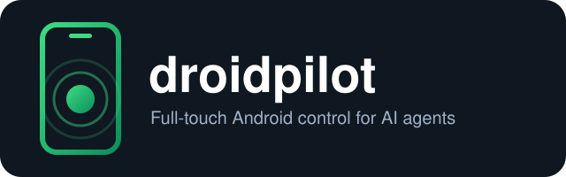

<p align="center"></p>

<p align="center">
  
  
  
  
</p>

# droidpilot

droidpilot lets an AI coding agent use a real Android phone. The agent looks at the screen and touches it like a finger.

droidpilot is an [MCP](https://modelcontextprotocol.io) server. Any agent that supports MCP can use it. Examples: Claude Code, Codex, Gemini CLI, Kiro.

## What it does

| Action | Tool |
|---|---|
| Look at the screen | `observe`, `screenshot`, `ui_tree` |
| Touch | `tap`, `tap_element`, `double_tap`, `long_press` |
| Move a finger | `swipe`, `scroll` |
| Use two or more fingers | `pinch`, `gesture` |
| Type and press keys | `type_text`, `press_key` |
| Open an app | `open_app`, `list_apps` |
| Wait for the screen | `wait` |

Each action tells the agent if the screen changed (`screen_changed=yes` or `NO`). The agent can then find a failed tap.

## How it works

```
AI agent  --MCP-->  droidpilot  --scrcpy control socket-->  phone (real touch events)
                        |
                        +--adb screencap + uiautomator-->  screenshot + numbered UI elements
```

1. droidpilot sends touch events through the scrcpy control socket. This gives real multi-touch.
2. If scrcpy fails, droidpilot uses `adb shell input`. This gives one finger only.
3. droidpilot reads the screen with `screencap` and `uiautomator dump`.

## Quick start

Do these steps once on the phone:

1. Open Settings > About. Tap **Build number** 7 times.
2. Open Developer options. Turn on **USB debugging**.
3. On realme and Oppo phones, turn on **Disable permission monitoring**.
4. Set the USB mode to **File transfer**. Do not use USB tethering.
5. Connect the cable. Tap **Allow** on the phone.

Then run these commands on the computer:

```bash
source env.sh               # sets the paths for adb and scrcpy
uv run droidpilot doctor    # checks the phone and every layer
uv run droidpilot serve     # starts the MCP server
```

## Add to an agent

Use this command as the MCP server. The transport is stdio.

```bash
uv --directory /path/to/droidpilot run droidpilot serve
```

An example config is in [`examples/mcp.example.json`](examples/mcp.example.json).

## Commands

| Command | Use |
|---|---|
| `droidpilot serve` | Start the MCP server. |
| `droidpilot doctor` | Test adb, the phone, the screen, and touch. |
| `droidpilot clean` | Remove the files droidpilot put on the phone. |

## Test

```bash
uv run pytest                       # no phone needed
uv run python tests/e2e_device.py   # needs a phone or an emulator
```

## Known limits

- Each checked action takes about 5 seconds. See [docs/PERFORMANCE.md](docs/PERFORMANCE.md).
- Apps that block screenshots show a black screen. The UI tree can still work.
- Web views inside apps give only part of their UI to the tree.
- A phone without a PIN is easy to use. A phone with a PIN needs the user to unlock it.

## Documents

- [Performance and improvement plan](docs/PERFORMANCE.md)
- [Research summary](docs/RESEARCH.md)
- [Findings log](docs/FINDINGS.md)

## License

MIT. See [LICENSE](LICENSE).
